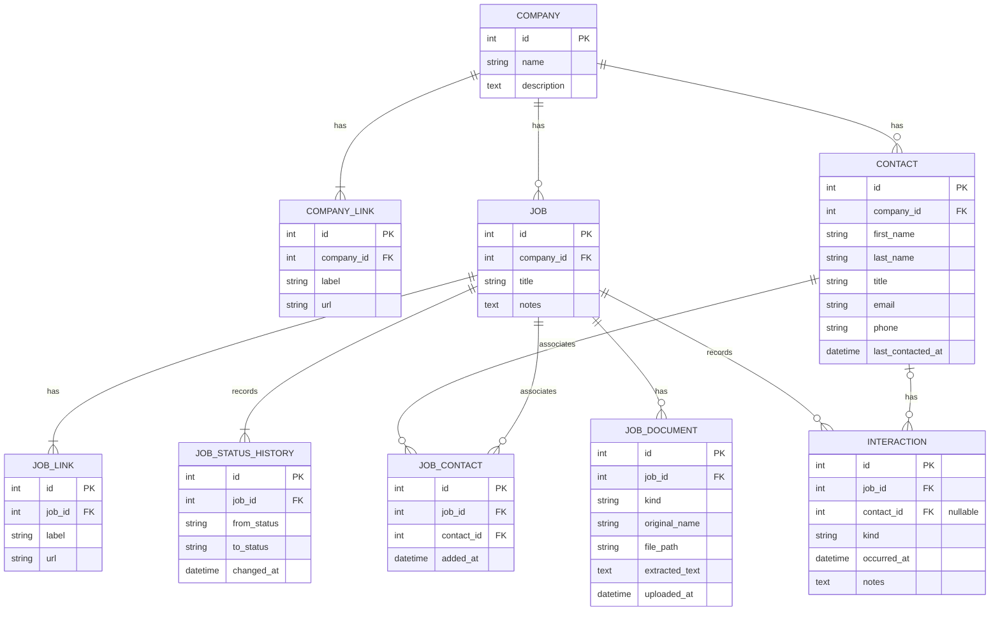

# Job application and contacts manager

## Problem and approach

Build a containerized Python web application for organizing job opportunities, application progress, job-related PDFs, company contacts, interactions, and search/analytics. Provide a drag-and-drop kanban board with jobs grouped by their current application status. Start with manually entered job links; keep the design cloud-migration friendly without adding job-site scraping to the first release.

Use Django for its integrated data modeling, forms, authentication foundation, and admin; PostgreSQL for relational data; and server-rendered pages for a focused CRUD-oriented first release. Package the application with Docker and persist PostgreSQL data and uploaded PDFs in named Docker volumes outside their containers, behind a storage abstraction so object storage can be introduced later.

## Database relationship diagram

- **Jobs and interactions**
  - Every interaction belongs to exactly one job and may involve zero or one contact.
  - Jobs may initially have no interactions, but each logged interaction must have a job.
- **Links**
  - Each company and each job must have one or more links, stored in separate link tables.
- **Job and contact relationships**
  - A job/contact association is unique per pair.
  - Both records in a job/contact association must belong to the same company.
- **Status history**
  - Job status and status-change times are stored in `JOB_STATUS_HISTORY`.
  - `JOB` has no separate status, found-date, or applied-date fields.
- **Contacts and documents**
  - `CONTACT.last_contacted_at` is maintained from interaction history.
  - Document file bytes live in configured storage.
  - Document metadata and extracted text live in the database.

## Scope decisions

- **Application and deployment**
  - Initial release is single-user/private deployment. Do not build multi-tenant account management.
  - Add and edit job postings manually. Defer automated job-site discovery.
- **Jobs and application tracking**
  - Track the current application stage and preserve stage-change history.
  - Provide a drag-and-drop kanban jobs board with the stages Job Found, Applied, Acknowledged, Recruiter Screen, Interview, Offer Extended, and Rejected. Moving a card or changing status on the job detail page creates an audit-history entry.
  - Provide a detailed job view with company and position details, attached documents with PDF preview, associated contacts, and a chronological feed combining status changes and interactions.
  - Provide a confirmed delete action on the job detail page that removes the job and its related records and uploaded PDF files.
  - Do not store job location, description, or salary range; store job and company URLs as related links rather than columns on their parent records.
- **Companies, contacts, and interactions**
  - Model companies, jobs, contacts, and interactions so each job can have zero or more contacts; allow contacts to be associated with multiple jobs at the same company.
  - Provide a filterable contact directory by company, last-contact date, and role/title. Automatically maintain each contact's last-contacted date when an interaction is recorded.
  - Highlight contacts not contacted in more than 30, 60, and 180 days; include contacts never contacted.
  - Provide a global quick-interaction action on every page for logging email, LinkedIn message, phone call, acknowledgement, interview, or other activity. Selecting a contact filters available jobs to jobs linked to that contact.
  - Require each interaction to refer to one job, allow its contact to be empty, and do not track interaction direction. Include acknowledgement as an interaction kind.
- **Documents and search**
  - Store PDFs on persistent local storage through a replaceable storage interface.
  - Support job/application documents such as resumes and submitted application files.
  - Accept multiple PDF documents per job, including job descriptions, resumes, and cover letters. Extract text during upload for keyword search across documents.
- **Reports and analytics**
  - Report application counts grouped by current status for applications applied within a selected date range.
  - Provide analytics for application funnel conversion (Applied to Acknowledged to Recruiter Screen to Interview to Offer Extended), weekly interactions by type, and stale contacts.

## Todos

- **Foundation and data model**

   1. Establish the Django project, containerized development setup, and PostgreSQL configuration.
   2. Extend the data model for interaction types, contact last-contacted dates, document text extraction, and analytics; add migrations and relationship validation.

- **Core workflows**

   <ol start="3">
   <li>Implement the job, company, and contact workflows, including a drag-and-drop status board, detailed job activity feed, and filterable contact directory.</li>
   <li>Implement global quick interaction logging.</li>
   </ol>

- **Documents and reporting**

   <ol start="5">
   <li>Implement multi-file PDF upload, preview, download, deletion, text extraction, and keyword search using persistent storage.</li>
   <li>Add application funnel, weekly outreach, application status/date-range, and stale-contact reports.</li>
   </ol>

- **Verification and documentation**

   <ol start="7">
   <li>Add focused tests and setup/usage documentation; verify the containerized app and core workflows.</li>
   </ol>

## Notes and considerations

- **Deployment and extensibility**
  - Keep application configuration externalized for future cloud deployment; do not bind the design to a particular cloud provider.
- **Application stages**
  - Use a controlled, code-defined stage vocabulary of Job Found, Applied, Acknowledged, Recruiter Screen, Interview, Offer Extended, and Rejected.
  - Preserve historical transitions rather than only overwriting the current stage.
  - User-defined stages are outside the first-release scope.
- **Interactions**
  - Store interaction date, type (email, LinkedIn message, phone, acknowledgement, interview, or other), notes, required job, and optional contact.
  - If a contact is selected, it must belong to the job's company and be associated with that job.
- **Reporting**
  - Base the application report's date filter on the first status-history entry for Applied.
  - Group application report results by each job's latest status-history entry.
  - Define funnel stages consistently and make the conversion denominator explicit.
  - Report all weekly interaction counts grouped by type.
- **Contacts**
  - Calculate contact last-contacted dates from interaction records.
  - Keep the displayed/stored value synchronized when interactions are created, updated, or removed.
  - Use calendar-day thresholds of 30, 60, and 180 days, and include contacts with no interaction history.
- **Documents**
  - Store document metadata and extracted text in the relational database.
  - Store file bytes in the configured storage backend.
  - Extract searchable text from PDFs with pdfplumber.
  - Retain the uploaded PDF as the source of truth.
