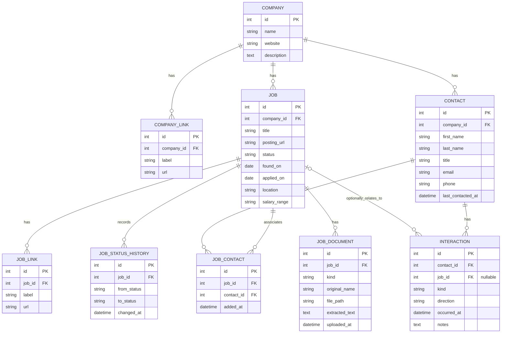

# Job application and contacts manager

## Problem and approach

Build a containerized Python web application for organizing job opportunities, application progress, job-related PDFs, company contacts, interactions, and search/analytics. Provide a drag-and-drop kanban board with jobs grouped by their current application status. Start with manually entered job links; keep the design cloud-migration friendly without adding job-site scraping to the first release.

Use Django for its integrated data modeling, forms, authentication foundation, and admin; PostgreSQL for relational data; and server-rendered pages for a focused CRUD-oriented first release. Package the application with Docker and provide a local persistent volume for uploaded PDFs behind a storage abstraction so object storage can be introduced later.

## Database relationship diagram

Each interaction belongs to one contact and may relate to one job. A job/contact association is unique per pair, and both records must belong to the same company. `CONTACT.last_contacted_at` is maintained from interaction history; document file bytes live in configured storage while metadata and extracted text live in the database.

## Scope decisions

- Initial release is single-user/private deployment. Do not build multi-tenant account management.
- Add and edit job postings manually. Defer automated job-site discovery.
- Store PDFs on persistent local storage through a replaceable storage interface.
- Track the current application stage and preserve stage-change history.
- Provide a drag-and-drop kanban jobs board with the stages Job Found, Applied, Acknowledged, Recruiter Screen, Interview, Offer Extended, and Rejected. Moving a card changes its status and creates an audit-history entry.
- Provide a detailed job view with company and position details, salary range, work location, attached documents with PDF preview, associated contacts, and a chronological feed combining status changes and interactions.
- Model companies, jobs, contacts, and interactions so each job can have zero or more contacts; allow contacts to be associated with multiple jobs at the same company.
- Support job/application documents such as resumes and submitted application files.
- Report application counts grouped by current status for applications applied within a selected date range.
- Provide a filterable contact directory by company, last-contact date, and role/title. Automatically maintain each contact's last-contacted date when an interaction is recorded.
- Highlight contacts not contacted in more than 30, 60, and 180 days; include contacts never contacted.
- Provide a global quick-interaction action on every page for logging email, LinkedIn message, phone call, interview, or other activity. Selecting a contact filters the optional related-job choices to jobs linked to that contact.
- Accept multiple PDF documents per job, including job descriptions, resumes, and cover letters. Extract text during upload for keyword search across documents.
- Provide analytics for application funnel conversion (Applied to Acknowledged to Recruiter Screen to Interview to Offer Extended), weekly outbound interactions by type, and stale contacts.

## Todos

1. Establish the Django project, containerized development setup, and PostgreSQL configuration.
2. Extend the data model for interaction types, contact last-contacted dates, document text extraction, and analytics; add migrations and relationship validation.
3. Implement the job, company, and contact workflows, including a drag-and-drop status board, detailed job activity feed, and filterable contact directory.
4. Implement global quick interaction logging.
5. Implement multi-file PDF upload, preview, download, deletion, text extraction, and keyword search using persistent storage.
6. Add application funnel, weekly outreach, application status/date-range, and stale-contact reports.
7. Add focused tests and setup/usage documentation; verify the containerized app and core workflows.

## Notes and considerations

- Keep application configuration externalized for future cloud deployment; do not bind the design to a particular cloud provider.
- Use a controlled, code-defined stage vocabulary of Job Found, Applied, Acknowledged, Recruiter Screen, Interview, Offer Extended, and Rejected; preserve historical transitions rather than only overwriting the current stage. User-defined stages are outside the first-release scope.
- Store interaction date, type (email, LinkedIn message, phone, interview, or other), notes, contact, and optional related job. The selected job must be associated with the selected contact.
- Base the application report's date filter on the applied date and group by each application's current status at report time.
- Calculate contact last-contacted dates from interaction records and keep the displayed/stored value synchronized when interactions are created, updated, or removed. Use calendar-day thresholds of 30, 60, and 180 days, and include contacts with no interaction history.
- Store document metadata and extracted text in the relational database and file bytes in the configured storage backend. Extract searchable text from PDFs with pdfplumber; retain the uploaded PDF as the source of truth.
- Define funnel stages consistently and make the conversion denominator explicit; report weekly outbound interaction counts grouped by interaction type.
